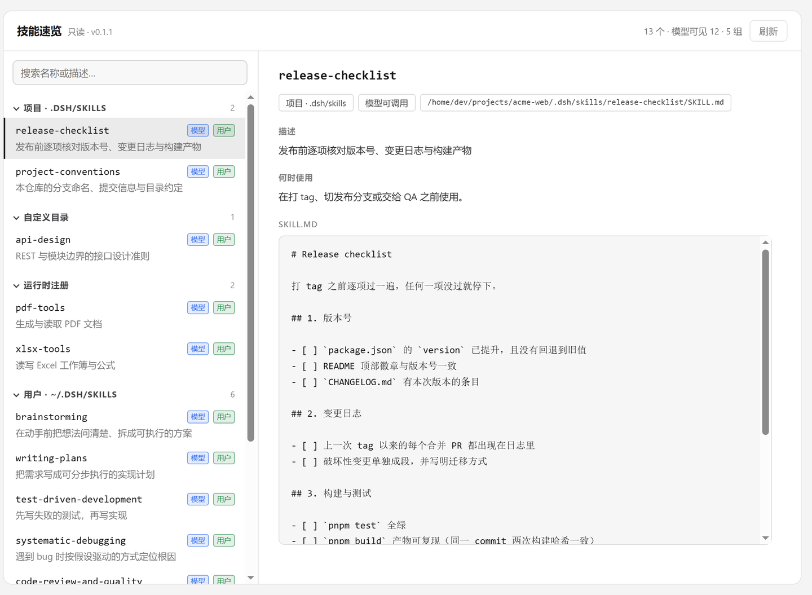
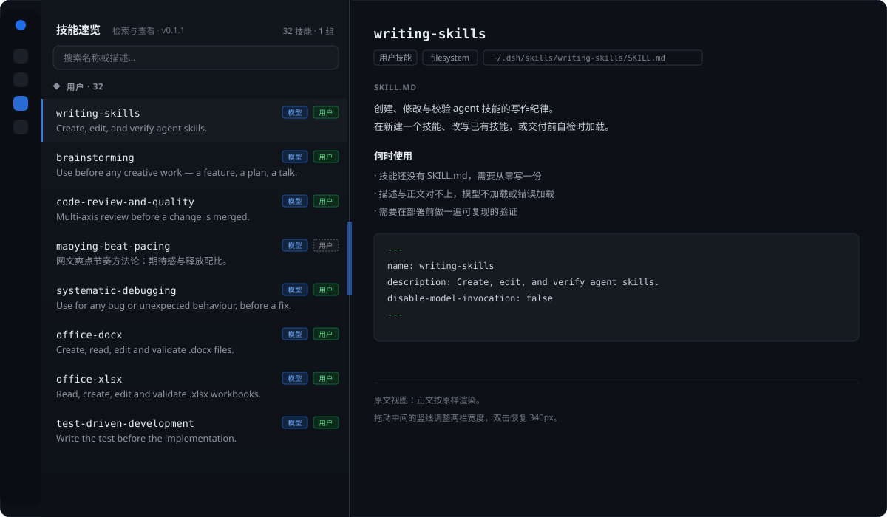

<div align="center">

# dsh-skill-peek

**轻量化的侧栏 skills 快速检索插件，仅检索及查看 SKILL.md 原文。**

<sub>Search and read SKILL.md from a sidebar panel — nothing else.</sub>


<a href="assets/screenshot-1.png"></a>

</div>

两个代码文件、零第三方依赖、不需要构建。装久了忘了有哪些技能，打开侧栏就能查。

## 功能

- **分组** —— 项目 / 自定义 / 运行时 / 用户 / 内置 / 其他；点标题折叠，搜索时自动展开
- **检索** —— 名称或描述即时过滤，`Esc` 清空
- **权限** —— 每行 `模型` / `用户` 两枚徽章，不可调用为灰虚线加删除线
- **原文** —— 来源、`provider`、路径、描述、何时使用、`SKILL.md` 全文
- **分栏** —— 拖动分隔条调宽度，双击回 340px，聚焦后方向键微调

## 安装

需要 DSH `>= 0.2.1-rc.3` 的 Web profile。

在 profile 的 `package.json` 里把本仓库作为本地依赖，并加进 `dsh.profile.bundles`：

```json
{
  "dependencies": { "dsh-skill-peek": "link:<本仓库绝对路径>" },
  "dsh": { "profile": { "bundles": ["…原有的一串…", "dsh-skill-peek"] } }
}
```

重启 DSH，左侧面板列表里出现「技能速览」。

也可以直接跑 `node tools/install-profile.mjs`：它会建 junction、写上面两处，profile 目录默认 `~/.dsh/profiles/desktop`，可用第一个参数覆盖；`tools/uninstall-profile.mjs` 撤销。

## 接口

| 路由 | 返回 |
| --- | --- |
| `GET /api/skill-peek/list` | 技能数组：名称、描述、来源、路径、调用权限 |
| `GET /api/skill-peek/read?name=&level=` | 单个 `SKILL.md` 全文 |

两条都只接受 loopback，否则 `403`。

## 说明

运行时注册但没有文件的技能显示「没有可读的 SKILL.md」；项目技能按当前活动会话的工作目录解析。

界面结构（矢量示意，可随主题缩放）：

<p></p>

## 开发

```bash
node tools/smoke.mjs               # 宿主路由 + UI 渲染 + 折叠 / 搜索 / 分隔条
node tools/dump-preview-data.mjs   # 刷新 preview/data.js
```

## License

[MIT](LICENSE)
